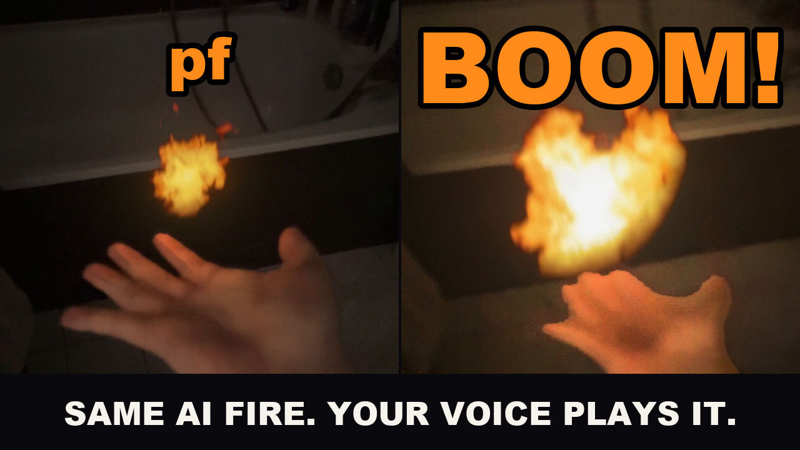
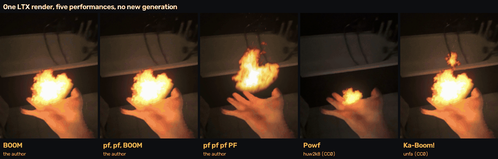
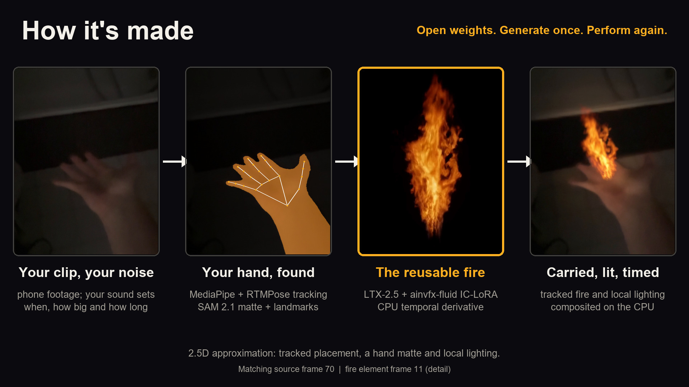

# Cue the Boom

**Generate a VFX effect once with LTX-2.5 in ComfyUI, then perform it on your hand with your voice, on a CPU.**

[](https://github.com/grzegorzszmulik22/cue-the-boom/releases/tag/contest-2026-10-30)

**[Watch the demo video](https://github.com/grzegorzszmulik22/cue-the-boom/releases/download/contest-2026-10-30/cue-the-boom-demo.mp4)** (1:54, MP4) · **[Try it in your browser](https://gshcloud-cue-the-boom.hf.space)** (Hugging Face Space, CPU, nothing to install) · [Technical details](TECHNICAL.md)


<sub>One stored LTX-2.5 render, five recorded performances by three people. When it fires and how big it plays come from the voice.</sub>

## What makes it different

Sound-driven video generation usually makes a new clip for every sound. Cue the Boom separates generation from performance: LTX-2.5 with the [ainvfx-fluid](https://huggingface.co/AInVFX/ainvfx-fluid) IC-LoRA renders an effect once, over black, and from then on your voice is the instrument. It decides when each hit fires, how big it plays and how long it burns, while the CPU tracks your hand, mattes it, lights your skin and composites the same element again. Built on open weights only, as an entry for Comfy's [Open Source Higgsfield](https://comfy.org/open-source-higgsfield) contest (October 2026).

| In numbers | |
| --- | --- |
| LTX-2.5 renders behind the palm fire in the gallery | 1 |
| Recorded performances of that render (the author and four CC0 voices) | 7 |
| New model generations for those performances | 0 |
| Scene renders with the CueSync nodes: single hits within one frame of their cue | 37 of 42 (0 of 42 straight from the model) |
| A new fire performance on a desktop CPU (Ryzen 9 7900X) | 21-53 s |
| GPU needed to try it | none |

## How it works



1. **Read the cue.** Onset and loudness-envelope analysis of a recorded sound sets when each hit fires (up to four per take), how strong it is and how long a held sound lasts.
2. **Render once.** A ComfyUI workflow, sent through the Comfy Python SDK, renders the effect with LTX-2.5 and ainvfx-fluid over black, from a guide video painted from that cue.
3. **Find the hand.** MediaPipe and RTMPose track it; the matte comes from SAM 2.1 on a GPU or from MediaPipe's segmenter on the CPU.
4. **Carry, light, time.** The stored element follows the hand, passes behind the fingers, lights the skin and lands on each hit.
5. **Perform again.** A new take re-composites the same render on the CPU, with no new generation.
6. **Or render into a scene.** For a shot of an object, the CueSync ComfyUI nodes measure where the rendered effect starts and move it onto the cue.

Water and lightning are procedural CPU effects; the explosion combines a stored LTX fireball with a procedural blast. The timing evaluation, the matte, the lighting and the limits are in [TECHNICAL.md](TECHNICAL.md).

## Quick start (CPU, no GPU, no model download)

Needs git and Python 3.10+ (3.12 recommended). The studio ships prebuilt and the sample hands come with their fire rendered ahead of time. A shallow clone is about 300 MB.

```bash
git clone --depth 1 https://github.com/grzegorzszmulik22/cue-the-boom
cd cue-the-boom
python3 -m venv .venv
.venv/bin/pip install "./cuesync[server]"     # Windows: .venv\Scripts\pip install "./cuesync[server]"
.venv/bin/cuesync studio                      # Windows: .venv\Scripts\cuesync studio
```

Open http://127.0.0.1:8765, choose **Fire**, click **Perform this fire with your voice**, then record a "BOOM" with your microphone or click **Try a sample voice instead**. **Perform again** plays the same render in a new rhythm. The start page also offers a live webcam preview.

From the command line (the shot lands in `runs/bend/final.mp4`):

```bash
cuesync bend --plate samples/plates/hand_palm.mp4 --voice samples/voices/pf-pf-ka-boom.wav \
  --again samples/made_ahead/bending/hand_palm__boom__fire_burst
```

Rendering new elements needs ComfyUI with LTX-2.5 22B (int8) and ainvfx-fluid on a GPU (about 3 minutes on a 32 GB card). See [With a GPU](TECHNICAL.md#with-a-gpu) and [In ComfyUI](TECHNICAL.md#in-comfyui).

## Repository layout

| Path | Contents |
|---|---|
| [`cuesync/`](cuesync/) | Python core, CLI and render API: cue detection, guides, the Comfy SDK runner, timing, hand tracking, compositing (Apache-2.0) |
| [`comfyui-cuesync/`](comfyui-cuesync/README.md) | ComfyUI node pack: Analyze Sound, Hold Cue, Paint Scene, Paint Guide, Scene Shot, Object Matte, Composite |
| [`web/`](web/) | The studio (Next.js), built into `cuesync/src/cuesync/studio_static/` |
| [`effects/`](effects/) | Effect definitions as JSON |
| [`workflows/`](workflows/README.md) | ComfyUI workflows, canvas and API format (LTX-2.x Community License) |
| [`tools/`](tools/README.md) | Timing measurement, benchmarks, sample packing, README image generators |
| [`samples/`](samples/CREDITS.md) | Sample plates and voices, shots made ahead, the timing evaluation set, the element library |
| `deploy/space/`, `infra/pod/` | Hugging Face Space packaging; disposable rented-GPU setup for ComfyUI |

Tests: `pip install "./cuesync[server,dev]" && python -m pytest cuesync/tests`, and in `web/`, `npm ci && npx vitest run`. CI runs both.

## Credits and attribution

- **Models:** [LTX-2.5](https://huggingface.co/Lightricks/LTX-2.5) (Lightricks) and the [ainvfx-fluid](https://huggingface.co/AInVFX/ainvfx-fluid) IC-LoRA (AInVFX, Adrien Toupet), open weights under the LTX-2.x Community License. No weights are in this repository; files and pinned revisions are in [build/model-files.md](build/model-files.md). LTX-rendered outputs carry the model's terms.
- **Software:** ComfyUI (GPL-3.0), ComfyUI-LTXVideo (Lightricks), the Comfy Python SDK and comfy-api-proxy (Comfy Org), MediaPipe, RTMPose, SAM 2.1, Next.js, PyAV/FFmpeg, OpenCV.
- **Footage:** the `hand_palm`, `hand_point`, `hand_walk`, `hand_punch`, `hand_fist` and `hand_open` plates are the author's own hand and voice. `hand_cupped` is a Pexels clip by Kindel Media. The real-footage scene shots are processed from stock clips and photos under the Pexels License, the Pixabay Content License, CC0 and public domain. Other plates are LTX-2.5-generated stand-ins.
- **Voices:** besides the author's own recordings and synthetic presets, the samples use CC0 recordings from Freesound by huw2k8, Jedimichael, Reitanna, rykenn, Sadiquecat and unfa.
- **Other assets:** Poly Haven's CC0 Rock Boulder Dry (Dimitrios Savva, Rico Cilliers) and Rock 07 (Jenelle van Heerden); the Cinzel and Shojumaru fonts (SIL Open Font License 1.1).
- **Demo video only:** narration synthesized with [Kokoro-82M](https://huggingface.co/hexgrad/Kokoro-82M); background music generated with Meta's [MusicGen-small](https://huggingface.co/facebook/musicgen-small). Neither is part of the app.

Per-file sources, authors, links and licences are in [samples/CREDITS.md](samples/CREDITS.md) and [NOTICE.md](NOTICE.md). Third-party material keeps its own licence.

## License

Code is under the [MIT License](LICENSE), except [`cuesync/`](cuesync/LICENSE) (Apache-2.0) and [`workflows/`](workflows/LICENSE-LTX-2.x) (LTX-2.x Community License, derived from the ainvfx-fluid sample workflow). Exceptions and third-party notices are in [NOTICE.md](NOTICE.md).
